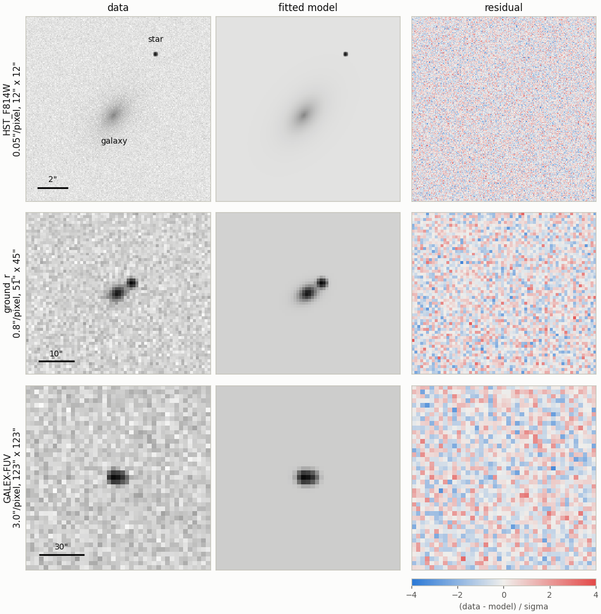

# AstroPhot-tool

Joint fitting of the same objects in several image cutouts, built on
[AstroPhot](https://github.com/Autostronomy/AstroPhot).

## The problem

An object is often observed by several instruments: space based to ground based
and far UV to far IR all get represented as pixels but can have very different
resolution and signal-to-noise. Each cutout has its own pixel grid, orientation,
PSF, noise and flux units. Fitting them one at a time gives a different position
and shape in every band, and the low resolution bands cannot separate blended
neighbours at all.

This tool fits all of the cutouts at once with a single model of the scene:

- every cutout is placed on one common tangent plane using its WCS,
- each object has **one** position and **one** set of structural parameters
  (axis ratio, position angle, Sersic index, radius, ...) shared by all cutouts,
- each object has an **independent flux in every cutout**.

The sharp images constrain the structure, and that structure is what lets the
fluxes be measured in the blurry ones.

## Install

Python 3.11 to 3.13. The dependencies are pinned to exact versions (see
`pyproject.toml`) so that every install is the same.

```bash
pip install . --extra-index-url https://download.pytorch.org/whl/cpu
```

The extra index gives the CPU only build of PyTorch, leave it out to get the
default (CUDA) build.

## Running a fit from Python

```python
from AstroPhot_tool import joint_multi_image

results, images = joint_multi_image(
    cutout_name,   # N names
    cutout,        # N arrays (H, W)
    variance,      # N arrays (H, W)
    mask,          # N arrays (H, W)
    psf,           # N arrays (Hp, Wp)
    wcs,           # N astropy WCS
    model_names,   # M names
    model_types,   # M AstroPhot model types
    init_pos,      # (M, 2) RA Dec
    init_params,   # M dicts
)
```

| Argument | Type | Description |
| --- | --- | --- |
| `cutout_name` | list of N `str` | A unique label for each cutout (band, filter, instrument, ...). |
| `cutout` | list of N arrays (H, W) | The images, in any flux units. Sizes may differ between cutouts. |
| `variance` | list of N arrays (H, W) | Variance of each pixel, in the square of the flux units of its cutout. Pixels with a variance that is not finite and positive are masked. |
| `mask` | list of N bool arrays (H, W) | `True` for pixels to ignore. |
| `psf` | list of N arrays (Hp, Wp) | PSF image for each cutout, sampled on the pixel grid of that cutout, with odd side lengths and large enough that the PSF has faded to zero at its edge. Normalized by the tool. |
| `wcs` | list of N `astropy.wcs.WCS` | WCS of each cutout, for the pixel grid of the cutout itself (not of its parent image). |
| `model_names` | list of M `str` | A unique label for each object to fit. |
| `model_types` | list of M `str` | AstroPhot model type of each object, e.g. `"sersic galaxy model"`, `"point model"`, `"flat sky model"`. `astrophot.Model.List_Models(usable=True, types=True)` lists them all. |
| `init_pos` | array (M, 2) | Starting RA and Dec of each object, in degrees. |
| `init_params` | list of M `dict` | Starting values of AstroPhot parameters for each object, lengths in arcsec and angles in radians. May be empty dicts: anything not given is initialized automatically, and fluxes are always initialized from the data. |

*Inputs of `joint_multi_image`. N is the number of cutouts and M the number of
objects (models); every list is in the same cutout or model order. H, W and Hp,
Wp are array shapes in pixels (rows, columns), which may be different for every
cutout.*

All inputs are required. The function returns two things, see
[Output](#output):

- `results`, a dictionary of the fitted parameters, their uncertainties and the
  fit statistics. It holds plain Python types and can be written directly as
  JSON.
- `images`, the diagnostic images of the fit. `images[name]["model"]` is the
  fitted model of the cutout called `name` and `images[name]["residual"]` its
  residual in units of the noise, both arrays with the shape of that cutout.

The flux-like AstroPhot parameters (`I0`, `I`, `Ie`, `I_R`, `Ib`, `flux`,
`weights`, `delta`) are fit separately in every cutout. Every other parameter
of a model is shared by all cutouts.

## Running a fit from the command line

`container_entrypoint.py` wraps the function for FITS files. It reads a JSON
config, runs one fit and writes `results.json`, a model and a residual image
(FITS) for every cutout, and a copy of the config as `config.used.json` to a
new output directory:

```bash
python container_entrypoint.py --config run1/config.json --output-dir run1/output
```

```json
{
  "cutouts": [
    {
      "name": "HST_F814W",
      "image":    {"path": "HST_F814W.fits", "hdu": "SCI"},
      "variance": {"path": "HST_F814W.fits", "hdu": "VAR"},
      "mask":     {"path": "HST_F814W.fits", "hdu": "MASK"},
      "psf":      {"path": "HST_F814W_psf.fits"}
    }
  ],
  "models": [
    {"name": "galaxy", "type": "sersic galaxy model", "ra": 150.12351, "dec": 2.23442},
    {"name": "star", "type": "point model", "ra": 150.12243, "dec": 2.23519, "params": {}}
  ]
}
```

- One entry in `cutouts` per image and one entry in `models` per object.
- A `path` is absolute, or relative to the config file. `hdu` is an extension
  number or name, the primary HDU if left out.
- The WCS is read from the header of the `image` HDU.
- Mask pixels which are not zero are ignored in the fit.
- `ra` and `dec` are the starting position in degrees, `params` holds optional
  starting values (the `init_params` above).
- The output directory must not already hold results, each run gets its own.

## Running with Docker

The `Dockerfile` packages the tool with its pinned dependencies. A container
runs the command line above once and exits, it is a batch job and not a
service. To build and run it on your own machine:

```bash
docker build -t astrophot-tool .
docker run --rm --user "$(id -u):$(id -g)" -v "$PWD/run1:/work" astrophot-tool \
    --config /work/config.json --output-dir /work/output
```

`-v` makes the directory with the config and FITS files visible inside the
container as `/work`, and `--user` makes the results belong to you.

### On CANFAR

Every GitHub release of this repository publishes the image to the CANFAR
container registry as `images.canfar.net/<project>/<repository>:<release>`.
Anyone with a CANFAR account can run it if that registry project is public,
otherwise membership of the registry project is needed.

It runs as a headless (batch) session, with the config, the FITS files and the
output directory on `/arc` storage (files inside the container are lost when it
ends). With the [CANFAR client](https://www.opencadc.org/canfar/latest/platform/sessions/batch/):

```bash
canfar login cadc
canfar create --name astrophot-fit headless <project>/<repository>:<release> -- \
    python /opt/astrophot-tool/container_entrypoint.py \
    --config /arc/projects/<my-project>/run1/config.json \
    --output-dir /arc/projects/<my-project>/run1/output
canfar ps --all            # status
canfar logs SESSION_ID     # messages from the fit
```

## Example

A fake galaxy (Sersic profile) with a star 4.3" away, as seen by three
instruments: 0.05"/pixel (HST like), 0.8"/pixel (ground based optical) and
3"/pixel (far UV like). Each cutout has its own size, rotation, PSF, noise and
flux units. In the far UV image the two objects are a single blob.



*Each row is one cutout. Left: the data. Middle: the fitted model, on the same
(arcsinh) brightness scale as the data. Right: the residual divided by the
noise. The model and residual panels are the images returned by the fit.*

One galaxy model and one point source are fit to the three cutouts together,
starting 0.1" from the true positions with every other parameter initialized
automatically. The fit has a chi-squared per degree of freedom of 1.005. The
true shape of the galaxy is `q` = 0.6, `PA` = 1.047, `n` = 1.8 and `Re` = 1.2",
and all fitted parameters, the far UV fluxes included, are within 1.3 sigma of
the truth.

To reproduce the figure and the results below:

```bash
python examples/example_fit.py
```

The same fake cutouts can be written as FITS files to try the command line:

```bash
python tests/fake_data.py example_run
python container_entrypoint.py --config example_run/config.json --output-dir example_run/output
```

### Output

The results of the example (shown with one parameter per line):

```json
{
  "message": "success",
  "chi2_ndf": 1.004801711549863,
  "iterations": 6,
  "crval": [150.1234, 2.234499999999997],
  "models": {
    "galaxy": {
      "model_type": "sersic galaxy model",
      "ra": 150.12351177537684,
      "dec": 2.2344161588709177,
      "shared": {
        "center": {"value": [0.4020854093420319, -0.30182804939314817], "uncertainty": [0.0036245131856979507, 0.002902030218686784], "units": "arcsec"},
        "q": {"value": 0.6063963079658738, "uncertainty": 0.007467061804354338, "units": "b/a"},
        "PA": {"value": 1.0425489622053425, "uncertainty": 0.011912001230834213, "units": "radians"},
        "n": {"value": 1.7849542450147198, "uncertainty": 0.035195640907488425, "units": "none"},
        "Re": {"value": 1.1853508351338111, "uncertainty": 0.01835098662422308, "units": "arcsec"}
      },
      "per_image": {
        "HST_F814W": {"Ie": {"value": 2.0358754047996577, "uncertainty": 0.05520276649200882, "units": "flux/arcsec^2"}},
        "ground_r": {"Ie": {"value": 823.9991355389333, "uncertainty": 23.717144086404407, "units": "flux/arcsec^2"}},
        "GALEX-FUV": {"Ie": {"value": 0.029886939329839268, "uncertainty": 0.0013672400704564749, "units": "flux/arcsec^2"}}
      }
    },
    "star": {
      "model_type": "point model",
      "ra": 150.12242714263948,
      "dec": 2.235194522430552,
      "shared": {
        "center": {"value": [-3.499621776080323, 2.500281908915861], "uncertainty": [0.00018118786084194856, 0.00019678075321321353], "units": "arcsec"}
      },
      "per_image": {
        "HST_F814W": {"flux": {"value": 29.956445095769272, "uncertainty": 0.12308103323823424, "units": "flux"}},
        "ground_r": {"flux": {"value": 5918.315185455752, "uncertainty": 65.5449956262845, "units": "flux"}},
        "GALEX-FUV": {"flux": {"value": 0.10781370440549011, "uncertainty": 0.009306156447560797, "units": "flux"}}
      }
    }
  }
}
```

- `message`, `chi2_ndf` and `iterations` describe the fit as a whole. Check
  that the message reports success before using the values.
- `crval` is the RA and Dec (degrees) of the common tangent point, the center
  of the first cutout.
- For each model, `ra` and `dec` are its fitted position in degrees. `shared`
  holds the parameters common to all cutouts and `per_image` the parameters fit
  in each cutout, under the cutout names as they were given.
- `uncertainty` is the 1 sigma uncertainty from the fit (`null` if it could not
  be computed).
- Fluxes are in the flux units of their own cutout. Lengths are in arcsec and
  angles in radians on the tangent plane, where `center` is the offset from
  `crval` with +x to the East and +y to the North. `PA` follows AstroPhot: it
  is measured from +y, counter-clockwise with +x drawn to the right.

The fit also gives two images for every cutout, on the pixel grid of that
cutout:

- **model**: the fitted scene, all models together as blurred by the PSF of the
  cutout, in the flux units of the cutout.
- **residual**: `(data - model) * sqrt(weight)` with weight = 1 / variance, so
  the residual in units of the noise. A good fit leaves values scattered around
  zero with a standard deviation of 1, and the sum of their squares is the
  chi-squared of the fit. Masked pixels are NaN.

From Python these are the arrays in `images`. The command line writes them to
the output directory as `<name>_model.fits` and `<name>_residual.fits`, each
with the WCS of its cutout in the header. `<name>` is the cutout name with
anything other than letters, digits and underscores replaced by an underscore
(`GALEX-FUV` becomes `GALEX_FUV`), so `results.json` from the command line has
one more entry which gives the file names under the names as they were given:

```json
  "images": {
    "HST_F814W": {"model": "HST_F814W_model.fits", "residual": "HST_F814W_residual.fits"},
    "ground_r": {"model": "ground_r_model.fits", "residual": "ground_r_residual.fits"},
    "GALEX-FUV": {"model": "GALEX_FUV_model.fits", "residual": "GALEX_FUV_residual.fits"}
  }
```

## When it works well

The tool does no detection, masking or background subtraction, it fits exactly
the scene it is given. It gives good results when:

- **The WCS of every cutout is accurate.** An object has one sky position for
  all cutouts and no offsets between images are fit, so the cutouts need to
  agree to well within the PSF of the sharpest one.
- **Everything in the cutouts is modeled or masked.** Every model covers its
  whole cutout, so the light of an unidentified neighbour, an artifact or a
  background that was not subtracted is absorbed by the models that are there.
  Add a model for it (a sky model for a background) or mask it.
- **Each `model_type` suits its object.** For example a point model for a star
  and a Sersic model for a galaxy. The wrong type biases the shared structure
  and with it the flux in every cutout.
- **The object has the same shape in every cutout.** That is the assumption
  which ties the images together, an object whose structure changes strongly
  with wavelength breaks it.
- **The variance maps and PSFs are right.** They set how much each cutout
  counts and how the shared structure is blurred in it.
- **The starting positions are close**, well within the size of the object.
- **The best cutout comes first.** The first cutout sets the tangent point and
  is used to initialize the structural parameters.

## Tests

```bash
pip install ".[dev]" --extra-index-url https://download.pytorch.org/whl/cpu
python -m pytest
```

The tests run on every pull request, where the Docker image is also built and
used for a fit before anything is published.
